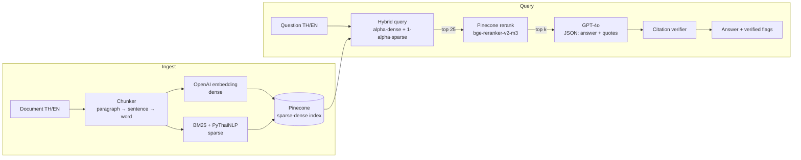

# RAG Pipeline with Hybrid Search · ระบบ RAG แบบ Hybrid Search

Bilingual (Thai + English) question-answering API over your own documents. It combines semantic and keyword search, reranks the results, answers with GPT-4o, and **checks every citation against the source text** before returning it.

ระบบถาม-ตอบจากเอกสารของคุณเอง รองรับ **ภาษาไทยและภาษาอังกฤษ** ค้นหาแบบผสม (ความหมาย + คีย์เวิร์ด) จัดอันดับซ้ำด้วย reranker ตอบด้วย GPT-4o และ **ตรวจสอบการอ้างอิงทุกจุดกับเนื้อหาต้นฉบับ** ก่อนส่งคำตอบ

[English](#english) · [ภาษาไทย](#ภาษาไทย)

---

## Architecture · สถาปัตยกรรม



| Layer | Tech |
|---|---|
| API | Python 3.12, FastAPI |
| Dense retrieval | OpenAI `text-embedding-3-small` (multilingual) |
| Sparse retrieval | BM25 (`pinecone-text`) + bilingual tokenizer (NLTK for EN, PyThaiNLP `newmm` for TH) |
| Vector store | Pinecone serverless, `dotproduct` sparse-dense index |
| Reranking | Pinecone hosted `bge-reranker-v2-m3` (multilingual) |
| LLM | GPT-4o, structured JSON output |
| Deploy | Docker (non-root, all model data baked in, starts offline) |

---

## English

### How it works

**1. Chunking (structure-aware, Thai-safe)**
Text is split by paragraph, then sentence, then word, and greedily packed into chunks of ≤ 400 tokens. The last ~60 tokens of each chunk are carried into the next, so a fact that falls across a boundary can still be retrieved.
- English sentences end at `. ! ?`. Thai has no full stop, so a space between Thai characters counts as a sentence break.
- Oversized sentences are split on **PyThaiNLP word boundaries**, never on raw token ids, so Thai characters are never cut in half.

**2. Hybrid retrieval**
Each chunk is stored as one Pinecone vector with two parts:
- **dense**: OpenAI embedding. Captures meaning and works across languages (a Thai question can find an English passage).
- **sparse**: BM25 term weights. Captures exact terms: product codes, names, numbers. The bilingual tokenizer segments Thai into words (`นโยบายการคืนสินค้า` → `นโยบาย`, `การคืน`, `สินค้า`), removes Thai and English stopwords, and stems English.

At query time, `alpha` sets the mix: `1.0` = semantic only, `0.0` = keyword only, `0.5` = balanced (default).

**3. Reranking**
The top 25 hybrid candidates are rescored by a multilingual cross-encoder (`bge-reranker-v2-m3`), which reads the question and chunk together and is much more precise. The best `top_k` go to the LLM.

**4. Generation**
GPT-4o gets the numbered sources and must return JSON: an answer with `[n]` markers, plus a **verbatim quote** from each cited source. It answers in the language of the question and treats sources as data, not instructions (prompt-injection guard).

**5. Citation verification**
No LLM is involved in this step. The code checks:
- each quote actually appears in the chunk it cites (ignoring case, punctuation and spacing; Thai vowel and tone marks are preserved)
- each quote is at least 8 characters, so trivial quotes like "the" can't pass
- every `[n]` in the answer is backed by a verified quote

The response includes `verified` (true only if everything checks out), `verified` on each citation, and `unsupported_markers`. Your UI can then show a warning or hide the claim.

### Quick start

```bash
cp .env.example .env        # set OPENAI_API_KEY, PINECONE_API_KEY, optional API_KEY
docker build -t rag-hybrid .
docker run --env-file .env -p 8000:8000 rag-hybrid
```

The Pinecone index is created automatically on first ingest. Interactive docs: `http://localhost:8000/docs`.

### API

All endpoints except `/health` require the `X-API-Key` header when `API_KEY` is set.

| Method | Path | Body | Purpose |
|---|---|---|---|
| GET | `/health` | none | Liveness check |
| POST | `/ingest` | `{"documents":[{"id","text","source?"}]}` | Add or replace documents (same `id` replaces old chunks) |
| POST | `/ingest/file` | multipart `file` (UTF-8 .txt/.md, ≤ 10 MB) | Upload a file; its filename is the id |
| POST | `/query` | `{"question","top_k?":5,"alpha?":0.5}` | Ask a question |

```bash
curl -X POST localhost:8000/ingest/file -H "X-API-Key: $API_KEY" -F file=@คู่มือพนักงาน.md

curl -X POST localhost:8000/query -H 'content-type: application/json' -H "X-API-Key: $API_KEY" \
  -d '{"question":"นโยบายการคืนสินค้ากี่วัน?"}'
```

Example response:

```json
{
  "answer": "สามารถคืนสินค้าได้ภายใน 30 วันนับจากวันที่ได้รับสินค้า [1]",
  "citations": [{"source_id": 1, "quote": "คืนสินค้าภายใน 30 วัน นับจากวันที่ได้รับสินค้า", "verified": true}],
  "unsupported_markers": [],
  "verified": true,
  "sources": [{"n": 1, "id": "...", "source": "คู่มือพนักงาน.md", "score": 0.91, "text": "..."}]
}
```

### Configuration

| Env var | Default | Notes |
|---|---|---|
| `OPENAI_API_KEY` | required | |
| `PINECONE_API_KEY` | required | |
| `API_KEY` | unset | When set, protects `/ingest*` and `/query` |
| `PINECONE_INDEX` | `rag-hybrid` | |
| `PINECONE_CLOUD` / `PINECONE_REGION` | `aws` / `us-east-1` | |
| `EMBED_MODEL` / `EMBED_DIM` | `text-embedding-3-small` / `1536` | `text-embedding-3-large` / `3072` is stronger for Thai (requires a new index) |
| `LLM_MODEL` | `gpt-4o` | |
| `RERANK_MODEL` | `bge-reranker-v2-m3` | also `cohere-rerank-3.5`, `pinecone-rerank-v0` |
| `CHUNK_TOKENS` / `CHUNK_OVERLAP` | `400` / `60` | |
| `BM25_PARAMS` | `bm25_params.json` | Path to your own fitted BM25 statistics |

### Tests

```bash
docker run --rm rag-hybrid python test_rag.py
```

The tests cover English and Thai chunking (limits respected, no broken characters), the bilingual tokenizer, ASCII-safe ids for Thai filenames, and citation verification: real, fabricated, missing, out-of-range, trivial, Thai, and mixed Thai-English.

### Project layout

```
app/
  main.py       FastAPI routes, auth, input validation
  rag.py        chunking, tokenizer, ingest, hybrid retrieval, rerank, generation, verification
  test_rag.py   offline tests (no API keys needed)
hooks/pre-commit  credential scanner (enable: git config core.hooksPath hooks)
Dockerfile
requirements.txt
.env.example
```

### Deployment & branches

- Deploy = the Docker image. Pass secrets via `--env-file` or your platform's secret store; never bake them into the image.
- Branch model: `main` = production, `uat` = UAT, `feature/<name>` branched from `uat`. Flow: `feature/*` → PR into `uat` → test → PR `uat` → `main`. Never PR a feature straight into `main`.
- Commits follow Conventional Commits (`feat(scope): ...`). After cloning, run `git config core.hooksPath hooks` so the credential scan runs before each commit.

### Known limits

- **BM25 weighting for Thai:** the built-in BM25 statistics (IDF) come from an English dataset (MS MARCO). Every Thai word looks equally rare, so Thai keyword matching works but isn't weighted by how rare a term is. The reranker corrects the final order. For better weighting, fit BM25 on your own corpus and set `BM25_PARAMS`, then re-ingest.
- Only UTF-8 text/markdown uploads; no PDF or DOCX parsing.
- Ingest runs inside the request, so large files are slow. Move it to a background queue if that becomes a problem.
- Changing the tokenizer or BM25 params requires re-ingesting, because the sparse term hashes change.

---

## ภาษาไทย

### ภาพรวมการทำงาน

**1. การแบ่งเอกสาร (Chunking) — รองรับภาษาไทย**
แบ่งข้อความตามย่อหน้า → ประโยค → คำ แล้วรวมเป็น chunk ขนาดไม่เกิน 400 tokens โดยท้าย chunk ประมาณ 60 tokens จะถูกนำไปต่อหัว chunk ถัดไป (overlap) เพื่อไม่ให้ข้อมูลที่อยู่คร่อมรอยต่อหายไป
- ภาษาไทยไม่มีจุดจบประโยค ระบบจึงถือว่า **ช่องว่างระหว่างตัวอักษรไทย** คือจุดแบ่งประโยค
- ประโยคที่ยาวเกินจะถูกตัดตาม **ขอบเขตคำของ PyThaiNLP** ไม่ตัดกลางตัวอักษร (สระ/วรรณยุกต์ไม่แตก)

**2. การค้นหาแบบผสม (Hybrid Retrieval)**
แต่ละ chunk ถูกเก็บใน Pinecone เป็น vector เดียวที่มีสองส่วน:
- **dense** — embedding จาก OpenAI จับ "ความหมาย" และค้นข้ามภาษาได้ (ถามภาษาไทย เจอเอกสารภาษาอังกฤษได้)
- **sparse** — ค่าน้ำหนักคำแบบ BM25 จับ "คำตรงตัว" เช่น รหัสสินค้า ชื่อ ตัวเลข ใช้ tokenizer สองภาษา: ตัดคำไทยด้วย PyThaiNLP (`นโยบายการคืนสินค้า` → `นโยบาย`, `การคืน`, `สินค้า`) ตัด stopword ไทย/อังกฤษ และ stem คำอังกฤษ

ปรับสัดส่วนด้วย `alpha`: `1.0` = ความหมายล้วน, `0.0` = คีย์เวิร์ดล้วน, `0.5` = สมดุล (ค่าเริ่มต้น)

**3. การจัดอันดับซ้ำ (Reranking)**
นำผลลัพธ์ 25 อันดับแรกมาให้ `bge-reranker-v2-m3` (รองรับหลายภาษา) อ่านคำถามคู่กับเนื้อหาแล้วให้คะแนนใหม่ ซึ่งแม่นยำกว่ามาก แล้วเลือก `top_k` อันดับที่ดีที่สุดส่งให้ LLM

**4. การสร้างคำตอบ (Generation)**
GPT-4o ได้รับแหล่งข้อมูลที่มีหมายเลขกำกับ และต้องตอบเป็น JSON: คำตอบพร้อมเครื่องหมาย `[n]` และ **ข้อความอ้างอิงที่คัดลอกตรงตัว** จากแต่ละแหล่ง ตอบในภาษาเดียวกับคำถาม และถือว่าเนื้อหาในเอกสารเป็นข้อมูล ไม่ใช่คำสั่ง (ป้องกัน prompt injection)

**5. การตรวจสอบการอ้างอิง (Citation Verification)**
ขั้นนี้ไม่ใช้ LLM ตรวจด้วยโค้ดล้วน:
- ข้อความอ้างอิงต้อง **ปรากฏจริง** ใน chunk ที่อ้างถึง (ไม่สนตัวพิมพ์ เครื่องหมายวรรคตอน และช่องว่าง โดยเก็บสระและวรรณยุกต์ไทยไว้ครบ)
- ต้องยาวอย่างน้อย 8 ตัวอักษร (กันการอ้างคำสั้น ๆ ที่เจอได้ทุกที่)
- ทุก `[n]` ในคำตอบต้องมีข้อความอ้างอิงที่ผ่านการตรวจแล้ว

ผลลัพธ์มี `verified` (เป็น true เมื่อผ่านทุกข้อเท่านั้น), `verified` ของแต่ละการอ้างอิง และ `unsupported_markers` เพื่อให้หน้าจอแจ้งเตือนหรือซ่อนข้อความที่ไม่มีหลักฐานได้

### เริ่มใช้งาน

```bash
cp .env.example .env        # ใส่ OPENAI_API_KEY, PINECONE_API_KEY และ API_KEY (ถ้าต้องการ)
docker build -t rag-hybrid .
docker run --env-file .env -p 8000:8000 rag-hybrid
```

ระบบจะสร้าง Pinecone index ให้อัตโนมัติเมื่อ ingest ครั้งแรก ดูเอกสาร API ได้ที่ `http://localhost:8000/docs`

### API

| Method | Path | ใช้ทำอะไร |
|---|---|---|
| GET | `/health` | ตรวจสถานะ |
| POST | `/ingest` | เพิ่ม/แทนที่เอกสาร (ใช้ `id` เดิม = แทนที่ของเก่า) |
| POST | `/ingest/file` | อัปโหลดไฟล์ .txt/.md (UTF-8, ≤ 10 MB) ชื่อไฟล์ภาษาไทยได้ |
| POST | `/query` | ถามคำถาม `{"question", "top_k", "alpha"}` |

ถ้าตั้ง `API_KEY` ไว้ ต้องส่ง header `X-API-Key` ทุก endpoint ยกเว้น `/health`

### Deploy และ Branch

- Deploy ด้วย Docker image ส่ง secret ผ่าน `--env-file` หรือ secret store ของแพลตฟอร์ม ห้ามฝัง key ไว้ใน image
- Branch: `main` = production, `uat` = UAT, `feature/<name>` แตกจาก `uat` → PR เข้า `uat` → ทดสอบ → PR `uat` → `main` (ห้าม PR feature เข้า `main` ตรง)
- Commit ใช้รูปแบบ Conventional Commits หลัง clone ให้รัน `git config core.hooksPath hooks` เพื่อเปิดการสแกน credential ก่อน commit

### ข้อจำกัด

- **น้ำหนัก BM25 ของคำไทย:** ค่าสถิติ BM25 (IDF) ที่ติดมากับระบบมาจากชุดข้อมูลภาษาอังกฤษ (MS MARCO) คำไทยทุกคำจึงดูหายากเท่ากัน ค้นคีย์เวิร์ดไทยได้แต่ยังไม่ถ่วงน้ำหนักตามความหายากของคำ ส่วน reranker จะช่วยจัดอันดับสุดท้ายให้ถูกต้อง หากต้องการแม่นขึ้น ให้ fit BM25 กับเอกสารของคุณเอง ตั้งค่า `BM25_PARAMS` แล้ว ingest ใหม่
- รองรับเฉพาะไฟล์ข้อความ UTF-8 / markdown ยังไม่รองรับ PDF หรือ DOCX
- การ ingest ทำในคำขอเดียวกัน ไฟล์ใหญ่จะช้า ถ้าเป็นปัญหาควรย้ายไปทำใน background queue
- เปลี่ยน tokenizer หรือค่า BM25 แล้ว ต้อง ingest เอกสารใหม่ทั้งหมด
